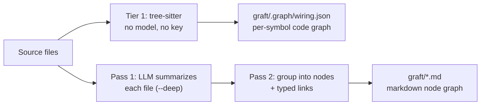

<div align="center">

<picture>
  <source media="(prefers-color-scheme: dark)" srcset="assets/trail-code-banner-dark.png">
  
</picture>

### The self-learning context layer for coding agents.

Trail-code gives Claude Code, Cursor, Codex and other coding agents a map of your code, and what your team has learned about it.

| | Code map (previously graft) | Learnings |
|---|---|---|
| **What is it?** | An index of your code: every function and who calls it, so your agent sees what a change can break | What you, your agents and your team have learned and decided |
| **What does it do for your agent?** | Takes it straight to the right files | Lets it pick up where you and your team left off |
| **Where does it come from?** | Your code, read on your machine | Your conversations, as you work |

<a href="https://trendshift.io/repositories/92209?utm_source=trendshift-badge&utm_medium=badge&utm_campaign=badge-trendshift-92209" target="_blank" rel="noopener noreferrer"></a>

<p>
  <a href="https://github.com/trailhq/Trail-Code"></a>
  <a href="https://trailhq.com/graft"></a>
  <a href="https://discord.gg/zxmKweAA29"></a>
  <a href="https://www.npmjs.com/package/@trailhq/trail-code"></a>
  <a href="https://www.npmjs.com/package/@nanonets/graft"></a>
  <a href="https://nodejs.org"></a>
  
  
  <a href="TELEMETRY.md"></a>
  <a href="https://scorecard.dev/viewer/?uri=github.com/trailhq/Trail-Code"></a>
</p>

### **46% fewer tool calls**, **60% less time**, and more real issues solved.

| | Cold agent | Agent with the graft map |
|---|---|---|
| Tool calls, 162 runs | baseline | **46% fewer** |
| Uncached input tokens, 162 runs | baseline | **42% fewer** |
| Time, 162 runs | baseline | **60% less** |
| SWE-bench Verified, 50 real issues | 27 solved (54%) | **33 solved (66%)** |

```bash
npm install -g @trailhq/trail-code && trail init
```

</div>

> [!NOTE]
> **Graft is now Trail-code.** Graft lives on as the graft map, and every `graft` command still works. What's new is learnings. [What changed](#coming-from-graft)

<p align="center">
  <picture>
    <source media="(prefers-color-scheme: dark)" srcset="assets/trail-code-how-it-works-dark.webp">
    
  </picture>
</p>

---

## What changes in your agent

| Without Trail-code | With Trail-code |
|---|---|
| Greps and opens file after file to find the code it needs | Gets the right files and functions with your prompt |
| Re-explores code a teammate already figured out last week | Starts from their learning: what they decided, what they ruled out, what to watch out for |
| Undoes a teammate's decision, because it never knew about it | `trail check` flags it before the PR, quoting who decided it and why |
| Finds out at merge time that a teammate changed the same code | Says so right after it edits code a teammate's open branch also changes, and whether the two clash |
| Has to be told the same things every session | Starts from what you've told it before: `trail init` finds what you said more than once in your past sessions |
| You write and update CLAUDE.md by hand | Learnings are saved from your conversations, in files you can read |

**Same model, more tasks solved.** On SWE-bench Verified (real GitHub issues, graded by the maintainers' own tests), Claude Sonnet 5 solved **33 of 50** issues with the graft map and **27 of 50** without it, using 23% fewer tokens. [Details](#swe-bench-verified)

**Cheaper and faster.** Across 162 runs of the same agent on the same tasks: **32% lower cost**, **42% fewer uncached input tokens**, **60% less time**, and the same share of correct answers. On PocketBase, 15 real tasks ran **21% cheaper** and **14% faster**. [Details](#benchmark)

---

## Contents

- [How it works](#how-it-works)
- [Quick start](#quick-start)
- [Part 1: The graft map](#part-1-the-graft-map), your code
- [Part 2: Learnings](#part-2-learnings), what you, your agents and your team know
  - [Four kinds, three places](#four-kinds-three-places) · [One decision, two teammates](#one-decision-two-teammates) · [A learning is a file](#a-learning-is-a-file) · [Your agent does the saving](#your-agent-does-the-saving)
- [Your team](#your-team)
- [What stays on your machine](#what-stays-on-your-machine)
- [Benchmark](#benchmark) · [SWE-bench Verified](#swe-bench-verified) · [Tested on popular repos](#tested-on-popular-repos)
- [FAQ](#faq)
- Reference: [How the graph gets built](#how-the-graph-gets-built) · [Supported languages](#supported-languages) · [What's in a node](#whats-in-a-node) · [What runs where](#what-runs-where) · [Agent integration](#agent-integration) · [CLI](#cli) · [Search & orient](#search--orient-trail-grep--trail-map) · [Monorepos](#monorepos-submodules--multi-repo-folders) · [Visualize it](#visualize-it-trail-viz) · [Development](#development)

---

## How it works

Trail-code has two parts. Both run on your machine.

1. **The graft map: your code.** `trail init` parses your repo with tree-sitter into a map of every file, function and who calls what. No model, no API key. It refreshes itself when the code changes, uncommitted edits included. Your agent gets pointers to the matching files and functions with each prompt, and sees what depends on a file right after it edits it.
2. **Learnings: what you, your agents and your team know.** When a session works something out, or you correct how something is done, your agent saves it as a learning. The next session on that code, yours or a teammate's, starts from it instead of digging again. Learnings about the code are committed with the code; learnings about you stay on your machine. On day one, `trail init` starts you off with what you told Claude more than once in your past sessions, and what reviewers flagged on more than one of the repo's merged PRs.

The graft map tells your agent *where* things are. Learnings tell it *why* they are that way, and *how* the work gets done here.

---

## Quick start

```bash
npm install -g @trailhq/trail-code   # install the CLI, once
trail init                      # in your repo: build the graft map, set up .trail/, wire your agents
```

That is the whole setup. `trail init` asks which of your coding agents to wire up, builds the graft map from your code, creates `.trail/` for the repo's learnings, and adds a statusline and hooks to Claude Code. It also reads your past Claude Code sessions in the repo, once, for what you told Claude more than once, and saves those as learnings. Your own Claude Code does that reading, in about a minute. Then work the way you always do. No daemon, no server, nothing to babysit: it is all files.

Commit the setup so your teammates get it too. The graft map itself, in `graft/`, is a local cache like `node_modules` and is added to `.gitignore`, so it stays out of the commit:

```bash
git add .claude .mcp.json .trail .gitignore .ignore && git commit -m "set up Trail-code"
```

Teammates' Claude Code reads the learnings in `.trail/` even before they install anything, and tells them once how to get the rest.

`trail init --dry-run` shows the agent wiring it would write; `trail init --agents claude` wires Claude Code alone.

### Coming from graft?

Nothing breaks. The code map you know is now called the graft map, and it is one of Trail-code's two parts.

| | Before | Now |
|---|---|---|
| Name | graft | Trail-code |
| The code map | graft | the graft map (same thing) |
| Command | `graft` | `trail` (`graft` still works) |
| Package | `@nanonets/graft` | `@trailhq/trail-code` (the old one still works) |
| Learnings | None | New, see [Part 2](#part-2-learnings) |

`graft` and `@nanonets/graft` run the same code as `trail`, and print what they always printed.

Already have graft? `graft upgrade` adds the `trail` command next to it.

Repos that graft set up move to trail on their own: once the `trail` command is installed, each one moves the first time you open Claude Code in it. To move one right away, run `trail init` in it. Commit what changes so your teammates move too.


---

## Part 1: The graft map

Without a map, your coding agent starts every task blind. It greps a term, opens a file, follows an import, backs out and tries again, rebuilding a picture of a codebase it mapped an hour ago and threw away. That rediscovery burns most of a run's tool calls, tokens and time. People onboard to a codebase once. Agents onboard every single time.

The graft map builds that understanding once, and keeps it current:

- **Every file, function and caller.** Parsed with tree-sitter into a graph of symbols and who calls what. Deterministic, no model, no network, 23 languages.
- **The right code with every prompt.** In Claude Code, hooks add the matching files and functions to each prompt, and show what depends on a file right after your agent edits it (the "blast radius"). Cursor, Codex and other agents get the same map through MCP tools and their instruction files.
- **Always fresh.** Every query checks the working tree first (a few tens of milliseconds when nothing moved) and rebuilds only what changed, so answers describe the code as it is right now, uncommitted edits included.
- **Plain files you can read.** Linked markdown nodes your agent opens and greps like any other file. No embeddings, no index to keep warm.
- **Summaries if you want them.** `trail build --deep` adds plain-English summaries of each part of the system, written by the model provider you choose, under your own key.

| | Cold agent | Agent with the graft map |
|---|---|---|
| SWE-bench Verified, 50 real issues | 27 solved | **33 solved (+12 pts)** |
| Our benchmark, 162 runs | baseline | **32% lower cost, 42% fewer uncached input tokens, 60% less time** |
| PocketBase, 15 real tasks | baseline | **21% cheaper, 14% faster** |

How it is measured: [Benchmark](#benchmark), [SWE-bench Verified](#swe-bench-verified) and [Tested on popular repos](#tested-on-popular-repos). How it is built: [the reference](#how-the-graph-gets-built).

---

## Part 2: Learnings

Your agent forgets everything when a session ends. Next week, it digs through the same code again, or worse, undoes a decision it never knew was made. Your teammates' agents do the same.

Trail-code keeps what your agent works out as **learnings**, saved from your conversations as you work. The next session starts from what you, your agents and your team already know. You don't have to write any of it by hand.

### Four kinds, three places

Every learning has a kind (what it is) and a place (who it is for).

**Three places:**

| Place | What goes there | Where it lives | Who sees it |
|---|---|---|---|
| **Personal** | About you and your machine: your setup, your habits | `~/.trail/` | Only you. Never committed, never uploaded |
| **Repo** | About the code: why it is the way it is, how work gets done in it | the repo's `.trail/`, committed with the change | Everyone who clones the repo, even before they install Trail-code |
| **Team** | What your whole team has learned, across repos | a Trail workspace (soon) | Your team, on the team page |

Your agent picks between personal and repo: something about your own setup stays personal ("saved just for you"); something about the code goes in the repo ("saved for your team"). The team place will gather the repo learnings of every repo in your workspace, so your team sees them together.

**Four kinds:**

| Kind | Example | Personal | Repo | Team |
|---|---|:---:|:---:|:---:|
| **Decisions**: why the code is the way it is | *"Keep retries at 4. Ruled out 10: one call could block for over an hour."* | ✅ | ✅ | soon |
| **Preferences**: how you like things done | *"Use pnpm, not npm."* Saved when you correct your agent, and found in your past sessions by `trail init`. | ✅ | ✅ | soon |
| **Skills**: how a job is done here | *"Read rotation with page.Rotation(), never pdfcpu: it drops /Rotate."* | soon | soon | soon |
| **Guardrails**: what must never happen | *"Never push to main."* Checked before the command runs. | soon | soon | soon |

Decision or preference? Ask whether it points at specific code and goes stale when that code changes. If it does, it is a decision. If not, it is a preference.

### One decision, two teammates

A real test: two people, two clones of [hashicorp/go-retryablehttp](https://github.com/hashicorp/go-retryablehttp), headless Claude Code sessions.

**1. Anirudh works out why the retry count is 4.** Before committing, the agent saves what it found as a learning, and commits it with the change:

```text
✓ saved for your team · .trail/learnings/2026-10-09-keep-the-default-retry-count-at-anirudh.md
```

The reply ends with `📝 Committed · Kumar works in this part of the codebase, and their agents now get a 27k-token head start`.

**2. Kumar pulls and asks about the same code.** Kumar's Claude reads Anirudh's learning before exploring, answers from it in 11 seconds for $0.10, and ends with a line saying where the answer came from, like:

```text
📝 Started from Anirudh's learning · saved ~27k tokens
```

**3. Kumar raises the retry count to 10 anyway.** Before the PR, `trail check` compares the change with everything the team has learned:

```text
checking 1 changed file against 1 learning and 0 skills

✗ client.go:51
  changes defaultRetryMax from 4 to 10
  Anirudh · Oct 9: Keep defaultRetryMax = 4: ten retries with the
  default backoff can hold one Do() call for over an hour.

· 1 conflict · fix it, or say why in the commit message or PR description
```

Kumar's Claude explains the override in the commit.

**4. Anirudh edits the same constant.** Kumar's branch isn't merged yet. Right after the edit, Anirudh's Claude reads Kumar's change and says something like:

```text
🔀 trail · Kumar is also changing defaultRetryMax on kumar/retry. He raises it to 10 and you're lowering it, so the two clash.
```

None of this needs a server. Learnings travel through git, like the code they are about.

### A learning is a file

A decision is a short markdown file in `.trail/learnings/`, reviewed in the pull request like any other change:

```markdown
---
title: Keep the default retry count at 4
author: Anirudh
date: 2026-10-09
cost: { tokens: 27400 }
touches:
  - client.go
---

## Decided
- Keep defaultRetryMax = 4: ten retries with the default backoff can hold one Do() call for over an hour.

## Tried and ruled out
- Raising the default to 10 for one customer: worst case, a single Do() call blocks for over an hour.

## Watch out
- RetryWaitMax caps each wait at 30s, not the total: the waits add up with every retry.
```

`touches` is how the next session on `client.go` finds it. A learning also records what the session spent working it out, in minutes and tokens. That is where "saved ~27k tokens" comes from: what the learning took to work out, less what it costs to read.

Where everything lives:

```text
your-repo/
├── .trail/learnings/          learnings about this repo's code (commit them)
└── graft/                     the graft map, a local cache (gitignored)

~/.trail/                      your personal learnings, on this machine only
```

### Your agent does the saving

Your agent saves and uses learnings on its own, at these moments:

- **On day one, what you told Claude before.** `trail init` reads your own messages in the repo's past Claude Code sessions, leaving out tool output, pasted text and headless runs. It keeps only what you said in two or more sessions, and scrubs secrets.
- **After real digging, a decision.** When a turn took real work and nothing was saved yet, Claude Code is asked once a session to save a learning: what was decided, what was ruled out, what to watch out for. A summary, never a transcript, and nothing secret.
- **After a correction, a learning.** When you correct how something is done here, or state a rule for it, your agent saves that too, so nobody has to say it again.
- **Before each task, the learnings on it.** Each session starts with the learnings that apply to all work in the repo. Each prompt brings in the ones earlier sessions left on that code, above the code itself. A teammate's learning says whose it is.
- **Before a PR, the check.** Your agent is told to run `trail check` before it commits, pushes or opens a pull request.
- **Never rewrites history.** Your agent never edits an existing learning. When it goes against one, it says why in the commit and saves a new one.

The commands, if you want them:

```bash
trail note --title "<what it was about>"   # save a learning (the text on stdin); --personal keeps it in ~/.trail
trail check                                # check your branch against everything the team has learned
trail team                                 # what the team learned this week, and where work overlaps
trail status                               # the graft map, learnings and tokens saved, on one screen
```

---

## Your team

Learnings reach your teammates through git, with no server: commit `.trail/`, and every clone has them. Learnings on a teammate's pushed branch show up before it merges, marked "pushed and not merged yet", with only their first lines.

`trail team` shows the last 7 days in your terminal: what the team learned and where work overlaps.

```bash
trail team                     # this week's learnings and overlaps
```

Coming soon: a Trail workspace, for your team's view across repos. A team page will show who is learning what, how often learnings were reused, and where work overlaps.

---

## What stays on your machine

- **Your code.** The graft map is built on your machine with tree-sitter. No model, no network. The optional `trail build --deep` summaries go to the model provider you choose, under your own key.
- **Personal learnings.** Kept in `~/.trail`. Never committed, never uploaded.
- **Repo learnings.** Files in your repo, shared through git like any other file.
- **Your past sessions.** `trail init` reads your own messages from Claude Code's transcripts for the repo, on your machine. Your own Claude Code does the reading, with Claude Sonnet under your login, so your messages go only to Anthropic, and it counts toward your Claude usage. None of it goes to Trail.
- **Your PR reviews.** When `gh` is installed and signed in, `trail init` reads the review comments on the repo's last 50 merged PRs with it, under your GitHub login. Anything that looks like a secret is taken out, and your own Claude Code reads them the same way. None of it goes to Trail.
- **If you connect a Trail workspace.** No learning goes to Trail until you do. Once connected, the learnings in the repos you picked go to Trail, including those on teammates' pushed branches. So does a record of each search and check that used them: the search text, the files, and whose learnings were shown. That is how the team page counts reuse.
- **Anonymous usage stats.** Buckets and fixed labels only, never the title, text or paths of a learning. [`TELEMETRY.md`](TELEMETRY.md) lists every field. Turn it off with `trail telemetry disable` or `DO_NOT_TRACK=1`.

---

## Benchmark

An agent that reads the graft map should be cheaper and faster without getting more answers wrong. That's the whole claim, so we measured it instead of asserting it.

The harness ran three variants of the same agent loop on Claude Sonnet 5, with the same file tools: **cold** (explores from zero), **push** (a `trail ask --source` bundle up front), and **pull** (the `trail_find_code` and `trail_file_api` tools, nothing injected, context paid for only when asked). An Opus 4.8 judge scored correctness with a required-keyword floor, so a fast but wrong answer couldn't win by being fast. Cost is cache-aware: reads ≈0.1×, writes 1.25×, the billing model agents actually run under.

162 runs, two repos (this one and a real Node/Express auth service), 3 trials each, tasks split between single-file and multi-file questions.

| Metric (mean/task) | Cold agent | Agent with the graft map (push) |
|---|---|---|
| Cost ($) | 0.0429 | **0.0292 (32% lower)** |
| Uncached input tokens | 8,070 | **4,650 (42% fewer)** |
| Tool calls | 4.2 | **2.3 (46% fewer)** |
| Latency (s) | 39.8 | **15.8 (60% less)** |
| Correctness | 93% | 93% (equal) |

Push, the column above, gave up 3 correctness points on one corpus for its savings. The pull variant never answered worse than cold on any corpus, and gave up most of that speed for something bigger: correctness jumped to 98%, 5 points over cold, the strongest single result in the sweep. Push when speed is what you need; pull when being right matters more.

---

## SWE-bench Verified

The sweep above is our harness measuring our mechanism. So we ran the industry-standard one too: **SWE-bench Verified**, real GitHub issues from real repos, graded by the official `swebench` harness. No judge model, no similarity score: your patch is applied, the maintainers' own tests are run, and you either flip the failing test without breaking the passing ones or you don't.

**50 instances**, the same model on both arms (**Claude Sonnet 5**), the same Docker images, the same turn limits. The only difference is whether the graft map is wired in.

| Correctness & efficiency | Cold Claude Code | Claude Code with the graft map | Improvement |
|---|---|---|---|
| Correctness | 27 / 50 (54%) | **33 / 50 (66%)** | **+12 pts** |
| Tokens | 142.0M | **109.4M** | **23% fewer** |
| Cost | $52.34 | **$42.43** | **19% lower** |
| Tool calls | 1,370 | **1,031** | **25% fewer** |
| API requests | 2,455 | **1,875** | **24% fewer** |
| Wall-clock | 13,094s | **8,922s** | **32% less** |

The graft map resolved **33 of 50 instances** against cold Claude Code's 27, with 25% fewer tool calls, 23% fewer tokens and 32% less wall-clock time. Every correctness win has the same shape: the baseline patches one file and misses its siblings. On `django-11532` it patched 1 of the 5 files the fix requires and broke 18 previously passing tests, twice over. On `django-16263` it patched 1 of 4 and scored 102 / 103. The graft map found the rest, and on `django-16263` did it in half the tokens and half the time.

Two harnesses, two claims: the controlled sweep says the graft map is cheaper and faster, SWE-bench says it's also more correct.

<sub>Correctness over all instances; tokens, cost and calls over the instances both arms resolved, for a like-for-like comparison. Official SWE-bench Verified images and official `swebench` 4.1.0 grader, native x86_64.</sub>

---

## Tested on popular repos

The [benchmarks](#benchmark) measure the mechanism. The real test is whether the graft map helps an agent **ship real changes** on code people actually run, not just answer questions. So we benchmark it on popular open-source repos: **15 tasks each**, 10 real developer questions plus **5 actual implementation tasks** (real merged pull requests, each re-implemented from its base commit and scored against the files the maintainers actually changed). Same agent (Claude Opus), same file tools; the only difference is whether the graft map is wired in.

On PocketBase the graft map ran **21% cheaper and 14% faster** across the 15 tasks, and **2.6× cheaper** on the hardest cross-file question, with no loss of correctness: it reproduced the real merged PRs by touching the same files the maintainers did.

### PocketBase (Go, ~350 files)

| Aggregate over 15 tasks | Standard Claude Code | With the graft map |
|---|---|---|
| Cost | $13.91 | **$11.02 (−21%)** |
| Wall-clock | 2,044s | **1,762s (−14%)** |
| PRs reproduced | 5 / 5 | **5 / 5 (same files as the maintainers)** |

Cheaper and faster with no loss of correctness: the graft map reproduced all five merged PRs, touching the same files the maintainers did. The gap is widest on cross-file understanding: "how does auth work across OAuth2 providers" dropped from $2.19 to $0.84.

<details>
<summary><b>The 10 questions we asked</b></summary>

1. **Orientation**: Give me a map of PocketBase's architecture: the main subsystems and how an HTTP request flows through to the database.
2. **Entry-point trace**: Trace end-to-end what happens when a client creates a record via the REST API, from route handler to database write.
3. **Feature location**: I want to add a brand-new collection field type. Where do I hook it in, and which pieces must change?
4. **Bug localization**: Realtime subscriptions silently stop delivering events after a while. Where would you start looking, and why?
5. **Blast radius**: If I change the signature of the record-validation logic, what depends on it and what could break?
6. **Cross-file synthesis**: How does auth work across OAuth2 providers: where are tokens issued, validated, stored, and refreshed?
7. **Extensibility**: How do I use PocketBase as a Go framework to register a custom route plus an on-record-create hook?
8. **Security discovery**: Where is user input validated, and where are collection API access rules enforced before a query runs?
9. **Public API**: As an external app, how do I authenticate and then list and filter records over the REST API?
10. **Test verification**: Where are the tests for the record CRUD API, and what do they assert about access rules?

</details>

<details>
<summary><b>The 5 merged PRs we re-implemented</b></summary>

Each PR was reset to its base commit; the agent's diff was scored against the files the merged PR changed.

| PR | Type | What it does | Files the maintainers touched |
|---|---|---|---|
| [#6744](https://github.com/pocketbase/pocketbase/pull/6744) | feat | Generate & serve WebP thumbnails | `apis/file.go`, `tools/filesystem/filesystem.go` |
| [#6947](https://github.com/pocketbase/pocketbase/pull/6947) | fix | Uniform char distribution in regex random strings | `tools/security/random_by_regex.go` |
| [#6690](https://github.com/pocketbase/pocketbase/pull/6690) | refactor | Patreon OAuth2 to use `x/oauth2/endpoints` | `tools/auth/patreon.go` |
| [#2726](https://github.com/pocketbase/pocketbase/pull/2726) | perf | Drop a redundant admin-count query on a hot middleware path | `apis/middlewares.go` |
| [#3192](https://github.com/pocketbase/pocketbase/pull/3192) | fix | Restore prior API rules on automigration rollback | `plugins/migratecmd/templates.go` |

</details>

<details>
<summary><b>Method</b></summary>

Two clones of PocketBase at the same commit: one wired with `graft init`, one untouched and verified to have no graft map in it. Each task run headless (`claude -p`, Claude Opus) with an empty MCP config. Understanding questions were graded by whether the answer pointed to the right files and functions; PR tasks were scored on whether the agent's diff touched the same files as the merged PR. Every transcript was audited to confirm the graft map was actually used in one arm and absent from the other.

</details>

---

## FAQ

**Is this graft?**
Yes. Trail-code is graft's new name, and graft lives on inside it as the graft map. The command is `trail` and the package is `@trailhq/trail-code`; `graft` and `@nanonets/graft` run the same code, print what they always printed, and keep working.

**How is this different from CLAUDE.md or AGENTS.md?**
You write those by hand, keep them current by hand, and your agent can skip them. Trail-code saves learnings from your conversations, brings in only the ones about the code you're working on, checks your changes against them before a PR, and adds a map of your code. It works next to your instruction files: `trail init` never touches your `CLAUDE.md`.

**Will it fill up my context window?**
No. Each prompt gets only pointers to the matching code, and the learnings that match it, and a teammate's unmerged learnings show only their first lines. In our benchmark, uncached input tokens went down 42%.

**Do I need an API key?**
No. The graft map, the hooks, learnings and `trail check` all work without one. A key only adds the written summaries from `trail build --deep`.

**Do I need to sign in?**
No. Everything above works on your machine, and learnings reach your team through git. A Trail workspace, coming soon, is only for the team page across repos.

**Which agents does it work with?**
Claude Code gets the deepest setup: hooks, statusline, learnings with every prompt, and the ask to save one after real digging. Trail-code also wires Cursor, Codex and other `AGENTS.md` readers, Gemini CLI, GitHub Copilot, Windsurf, Kiro, Antigravity, Grok, Hermes and AdaL, and serves any agent that speaks MCP.

**What if it learns something wrong?**
A repo learning is a file in your pull request, so it gets reviewed like the code it is about. Delete or edit the file to drop it. Personal learnings are files in `~/.trail`, just as easy to change.

**Does it work in monorepos?**
Yes: one repo with many packages, submodules, and folders of separate repos. See [Monorepos](#monorepos-submodules--multi-repo-folders).

**What does it cost?**
The CLI is free and open source under the MIT license.

---

## How the graph gets built

The graft map is built in layers. Tier 1 is tree-sitter: every symbol and call edge, no model, no key. `trail build --deep` adds two language-model passes on top:

1. **Read each file.** Every source file is summarized once into a short description of what it does.
2. **Group into nodes.** Those summaries are grouped into a curated set of nodes (subsystems, key files, and concepts) with typed links between them. The graft map chooses the right level of detail for you instead of making one node per file, so a big repo becomes a few dozen readable nodes.



Every pass is cached by content hash, the LLM ones and the tree-sitter parse alike. Re-running only touches the files that changed, so the second build is fast and cheap (on this repo, 312 files: about 5s cold, about 0.6s after one edited file or with nothing changed). `trail build --no-reuse` forces a cold re-parse.

That cheapness is what lets **every query refresh the graph before it answers**. A retrieval call stats the tree against the last build's fingerprint (about 50ms on this repo), and rebuilds only if something moved, so `ask`/`grep`/`callers`/`skeleton`/`map` describe the code as it is right now, including edits that are unsaved to git: uncommitted, unstaged, or staged all look the same to the graft map. Git determines the visible file set; freshness compares the working-tree bytes rather than commit or index state. The refresh is structural and `$0`; it never calls the LLM. Turn it off per-command with `--no-refresh`, or everywhere with `GRAFT_NO_REFRESH=1`.

Alongside the markdown graph, `trail build` builds `graft/.graph/wiring.json` (a per-symbol code graph) plus a per-file wiring card mirroring your source tree. Tier 1 is pure tree-sitter (every function, class, and call edge; deterministic, no model, no network), which is why plain `trail build` needs no key. The `--deep` pass adds a one-line summary and a crux excerpt per symbol, cached by body hash.

---

## Supported languages

The graft map parses with tree-sitter at two levels of fidelity, plus an optional
compiler-grade layer, all `$0` and deterministic (no model, no key):

- **Full-fidelity**: hand-written extractors with scope-aware, cross-file call
  and import resolution:
  **TypeScript / JavaScript** (incl. JSX & TSX), **Python**, **Go**, **Java**,
  **Kotlin**, **PHP**, **Swift** (classes, structs, enums, actors, protocols;
  extension members attach to the extended type), **R** (`.R`/`.r`: plain
  functions, S3/S4/R6 classes and methods, roxygen `@export`,
  `library()`/`source()` imports), and **Vue** single-file components (their
  `<script>` blocks go through the TypeScript extractor).

- **Broad**: symbols (functions, classes, methods, types, …) plus name-resolved
  call edges via a generic tree-sitter extractor, one grammar per language:
  **Rust, C, C++, C#, Ruby, Scala, Elixir, Solidity,
  Dart, Clojure, Nix, Lua**, and **OCaml, Zig** (symbols only for now, no call edges).

- **Compiler-grade edges (opt-in)**: `trail build --lsp` adds precise
  `lsp_resolved` call edges (member calls the static pass can't type) when a
  language server is on your `PATH`. It uses the first one installed, in this
  order, one server per build: **rust-analyzer** (Rust), **clangd** (C/C++),
  **gopls** (Go), **pyright** (Python), **typescript-language-server** (TS/JS).
  It's best-effort: with no server installed the graph is unchanged.

Twenty-three languages, plus Vue single-file components. A file whose language isn't listed is skipped, not
indexed. Adding a broad-tier language is a small contribution; see
[CREDITS.md](CREDITS.md) for the folks who added the current set.

---

## What's in a node

A node is a single markdown file. Most code maps stop at an address: this thing lives in that file, on that line. That tells an agent where to look, not what it will find, so it still has to open the source and read. A graft map node holds the meaning inline, so the agent learns what it needs up front and opens the file only when it wants more.

Each node holds:

| Part | What it holds |
|---|---|
| **Summary** | A plain-English explanation of what the code does, written by the model and cached. It is there whether or not the code was ever documented, and it is regenerated when the source changes. |
| **Crux** | The handful of lines that actually carry the logic: the guard, the skip condition, the state change. Lifted straight from the source and stored inline, so the agent sees *how* it works, not just what. |
| **Sources** | The exact files the node is built from, each tracked by a content hash, so the graft map can tell precisely when a node has gone stale. |
| **Links** | Typed connections to other nodes (`depends_on`, `part_of`, `uses`, `implements`, `produces`), written as `[[wikilinks]]` your agent can follow. |
| **Your text** | Anything you write below the generated block. It is preserved across regenerations, so your own context is never overwritten. |

That is three depths in one file: the summary says *what* the code does, the crux shows *how*, and the sources point to the rest if the agent needs it. A plain index makes it read a whole file to learn one thing. A graft map node hands it the answer inline, and the follow-up read often never happens.

The crux is stored as the code itself, not as a line range, on purpose. Line numbers drift whenever unrelated code above them shifts, but the lines that matter do not. Keeping the text, not the numbers, means the crux stays correct even as the file around it moves.

_Summary, sources, links, and your text ship today in markdown nodes. The crux ships per-symbol in the code graph (`trail build --deep`); inlining it into markdown nodes is next._

---

## What runs where

- **On your machine, no key, no network:** the structural code graph. `trail build` (wiring graph + per-file cards), `trail build --check`, `trail ask`, learnings and `trail check` are deterministic. They never call a model.
- **Through your provider key:** the LLM-written parts. `trail build --deep` adds the concept nodes (file summaries + node synthesis) and the per-symbol summaries and cruxes. The graft map is vendor-neutral: set `GRAFT_PROVIDER` (`openai` for any OpenAI-compatible endpoint, `anthropic` for the native API, or `litellm` / `orcarouter` for a gateway that speaks the OpenAI-compatible format), your `GRAFT_API_KEY`, `GRAFT_MODEL`, and, for the `openai` wire format, `GRAFT_BASE_URL` to point at OpenRouter, Fireworks, Groq, a LiteLLM proxy, a local server, or OpenAI itself. Or pass `--provider/--model/--api-key/--base-url` on the command line. (`OPENROUTER_API_KEY` still works as a deprecated fallback, and `ORCAROUTER_API_KEY` as a second one.)
- **Through Trail, only if you connect a workspace:** the learnings in the repos you picked, and the searches and checks that used them. See [What stays on your machine](#what-stays-on-your-machine).
- **Anonymous usage stats:** a daily npm version check and one batched usage ping. The ping carries buckets and fixed labels only: never your code, file paths, repo name, symbols, queries, learnings or error messages. [`TELEMETRY.md`](TELEMETRY.md) is the complete list and `trail telemetry debug` prints exactly what your machine would send. Turn it off with `trail telemetry disable`, `DO_NOT_TRACK=1`, or by unchecking the box in `trail init`; it is off in CI and in any build from source.

Settings keep their `GRAFT_` names. See [`.env.example`](.env.example) for the full list (model, base URL, graph directory).

---

## Agent integration

One command wires Trail-code into the coding agents you use:

```bash
npm install -g @trailhq/trail-code && trail init
# detects your agents and writes each one's native instruction file;
# Claude Code additionally gets the live statusline + hooks below
```

On a terminal, `init` shows you every agent it knows about, flags the ones it detected (via their config directories), lists the exact files each would write, and wires only the ones you select. Claude Code is pre-selected; nothing else is. Selected agents get a marker-fenced Trail-code section in their shared instruction file (`AGENTS.md` for Codex, OpenCode and other CLIs that read it, `GEMINI.md`, `.github/copilot-instructions.md`), or a wholly-owned rule or skill file for the agents that use one, such as `.claude/skills/trail/SKILL.md` and `.cursor/rules/trail.mdc`. Claude Code is in the second group: `init` writes its own skill file and never touches your `CLAUDE.md`. Re-running only updates Trail-code's own section (or replaces the owned file) and never touches the rest of your content.

In Claude Code, the committed skill file is also how a teammate without Trail-code installed gets your learnings: it tells their agent where `.trail/learnings/` is, to read it before exploring, and to tell them once how to install the rest.

With no TTY to prompt on (CI, a Dockerfile, a piped shell), `init` writes **nothing** and prints the command to run instead. Pass `--agents <ids>` or `--yes` to make a scripted run explicit.

| Flag | Effect |
|---|---|
| `--agents <ids...>` | wire only these, no prompt; ids: `agents`, `adal`, `cursor`, `gemini`, `grok`, `hermes`, `antigravity`, `copilot`, `kiro`, `windsurf`, `claude` |
| `--yes`, `-y` | skip the prompt and wire every **detected** agent |
| `--dry-run` | print the agent wiring `init` would write, then exit without writing |
| `--all-agents` | write instruction files for every known agent, detected or not |
| `--no-agents` | Claude Code wiring only; skip other agents |
| `--list-agents` | print the known agent ids and exit |
| `--no-mcp` | skip MCP registration for agents other than Claude Code |
| `--no-hooks` | skip hook installation for agents other than Claude Code |
| `--no-statusline` | skip writing Claude Code `statusLine` (same as `GRAFT_NO_STATUSLINE=1`) |
| `--no-global` | skip writes outside this repo (the `~/.codex/` entries below) |

#### Writes outside the repo

Some agents also get **user-level** files, so the wiring follows you into worktrees and folders the repo's files don't reach:

| Agent | Path | What changes |
|---|---|---|
| Claude Code | `~/.claude/settings.json` | `SessionStart`, `UserPromptSubmit`, `PostToolUse` and `Stop` hooks |
| Claude Code | `~/.claude/helpers/graft-hooks.cjs` | the hooks shim they call |
| Claude Code | `~/.claude.json` | the `trail` MCP server |
| Codex (`agents`), when `~/.codex/` exists | `~/.codex/config.toml` | the `trail` MCP server |
| Codex | `~/.codex/hooks.json` | the same four hook events, matching `apply_patch\|Write\|Edit\|MultiEdit` after edits |
| Codex | `~/.codex/hooks/graft/graft-hooks.cjs` | the hooks shim |
| Antigravity | `~/.gemini/config/mcp_config.json` | the `trail` MCP server |
| Antigravity | `~/.gemini/skills/trail/SKILL.md` | its skill file |

These apply to **every** repo you open with that agent, not just this one. The picker labels them `machine-wide`, `--dry-run` lists them in their own section, and `--no-global` skips them all while still wiring the repo's own files.

### MCP server

`trail init` also registers the Trail-code MCP server with agents that support it, so these six tools appear natively, no shell required. Claude Code gets this too: `trail init` writes the server into the project's `.mcp.json` (restart Claude Code to load it). Run it by hand with `trail mcp [dir]`.

| Tool | Takes | What it's for |
|---|---|---|
| `trail_find_code` | a question | Ranked nodes with file:line, source inlined; usually the full answer, no follow-up read needed. |
| `trail_file_api` | a file path | Every signature in that file, no bodies: the API surface for a tenth of the tokens. |
| `trail_trace_calls` | a symbol | Who depends on it, or what it depends on with `direction: out`, N levels deep for blast radius. |
| `trail_find_all` | a regex | Every hit, grouped by enclosing symbol, ranked by how coupled that symbol is. |
| `trail_repo_map` | nothing | A first look at an unfamiliar repo: directory clusters, hubs, hotspots. |
| `trail_check_freshness` | nothing | Whether the local graph has drifted from the code. |

Every tool accepts an optional `root` to query another checkout, for example `trail_find_all` with `{"pattern":"readList", "root":"/tmp/review"}`. The path may name the checkout or one of its subdirectories; relative paths resolve from the server's root. Explicit roots must share the server checkout's Git common directory, so linked worktrees are accepted while independent clones, submodules and unrelated repositories are refused. Omitting `root` keeps the server's existing root selection, including workspace queries.

Each checkout uses its own graph and in-process cache. A fresh worktree can copy its main checkout's graph and refresh it before answering, just like `trail mcp /tmp/review`. A server started with `--dir` keeps its original source root and graph directory, and refuses to switch to another checkout. Tool results end with the resolved root and its current full `HEAD` commit (`unavailable` outside Git or before the first commit). HEAD identifies the checkout; queries still include uncommitted source edits, and refresh warnings still apply. A rejected root returns a soft tool error before graph access.

The same server still answers the old `graft_*` tool names. Register it by hand if your agent needs it explicit:

```json
{ "mcpServers": { "trail": { "command": "npx", "args": ["-y", "@trailhq/trail-code", "mcp"] } } }
```

Where a CLI agent supports user-level `hooks.json`, as Codex does, `init` also installs Trail-code's hooks there: session start, context with each prompt, blast radius and a `$0` graph re-sync after edits, and the end-of-turn sync (skip with `--no-hooks`).

### Claude Code (deep integration)

When Claude Code is selected (it is by default), it gets more than the skill file above. From then on, any Claude Code session opened in the repo gets:

- **a live statusline**: the graft map's size, how many learnings the repo has, and a `⚠ N stale` warning when the code has moved ahead of the map
- **auto-sync**: every query brings the graph up to date first, so an answer always describes the code as it is right now, uncommitted edits included. A query refreshes only what it reads; the markdown under `graft/` is refreshed by the background rebuild at the end of a turn that touched code. Both are structural and `$0`; auto-sync never calls the LLM on its own
- **context on tap**: each prompt pulls in the matching nodes and the learnings left on that code; editing a file surfaces what depends on it ("blast radius"); new sessions start with the repo map and how many learnings there are
- **the ask to save a learning**: after a turn of real digging with nothing saved, Claude is asked once a session to save one
- **overlap with teammates**: at session start, and every few minutes, it reads what teammates' open branches change, skipping any already merged or closed; when Claude edits a function or constant one of them also changes, it reads their change and tells you whether the two clash

<p align="center">
  
  <br/><sub>edit a file → blast radius appears inline → graph auto-resyncs → confirmed in the viewer</sub>
</p>

`trail init` is idempotent and never clobbers your existing `.claude/settings.json`: it merges its blocks and leaves the rest alone. A `statusLine` that is not Trail-code's is left untouched; re-running `init` refreshes Trail-code's own helper command if it is already installed. Pass `--no-statusline` (or `GRAFT_NO_STATUSLINE=1`) to skip installing one at all, since a project-level `statusLine` would otherwise hide a custom one in `~/.claude/settings.json`. Want the LLM summaries too? Run `trail build --deep` (with a key) whenever you like; auto-sync will never do it for you.

---

## CLI

`trail --help` lists the commands in four groups. Every `graft` command still works too.

```bash
# find code · your agent runs these
trail ask "<task>" [dir]             # the matching code and learnings: ranked nodes + exact file:line (no LLM, no key)
trail ask "<task>" --json            # machine-readable result
trail ask "<task>" --in <scope>      # narrow to one sub-project of a monorepo/multi-repo folder (see below)

trail grep "<regex>" [dir]           # exhaustive regex search over indexed files, grouped by enclosing symbol (no LLM, no key)
trail grep "<regex>" --in <path>     # narrow to files at or under this path prefix
trail grep "<regex>" -i --fixed      # case-insensitive; treat the pattern as a literal string, not a regex

trail skeleton <file> [dir]          # every signature in one file, no bodies: the API surface for ~1/10th the tokens (no LLM, no key)

trail callers <symbol> [dir]         # who calls/references/imports/implements/extends a symbol (no LLM, no key)
trail callers <symbol> --direction out  # the reverse: what the symbol itself calls/references
trail callers <symbol> -d N          # walk transitively out to depth N: full blast radius

trail map [dir]                      # token-budgeted repo orientation: dir clusters, hubs, hotspots (no LLM, no key)
trail map --max-dirs N               # raise/lower the number of directories shown

# ask / skeleton / callers / grep / map / blast all refresh the graph first if the working tree moved:
#   --no-refresh                     # answer from the graph exactly as it is on disk
#   GRAFT_NO_REFRESH=1               # same, for every command
#   GRAFT_REFRESH=hash               # hash every file instead of trusting size+mtime

# team memory
trail note --title "<about>" [dir]   # save a decision: what this session decided, tried and ruled out (the text on stdin)
trail note --personal                # about your own setup, not the code: keep it in ~/.trail, out of the repo
trail check [dir]                    # check your branch's diff against the repo's learnings, yours and your skills (exit 1 on a conflict)
trail check --base origin/main       # compare against this base instead of origin's default branch
trail team [dir]                     # what the team learned this week, who's working on what, and where work overlaps

# setup
trail init [dir]                     # pick which agents to wire (prompts on a terminal; writes nothing until you choose)
trail init --dry-run                 # list the agent wiring it would write, then exit
trail init --agents cursor kiro      # wire only these agents, no prompt (ids: agents, adal, cursor, gemini, grok, hermes, antigravity, copilot, kiro, windsurf, claude)
trail init --yes                     # no prompt; wire every detected agent
trail init --no-global               # skip writes outside this repo (~/.claude, ~/.claude.json, ~/.codex, ~/.gemini)
trail init --no-statusline           # skip Claude Code statusLine (same as GRAFT_NO_STATUSLINE=1)
trail init --no-build                # wire the files only; don't build the graph
trail init --all-agents              # wire every known agent, detected or not
trail init --list-agents             # list known agent ids and exit

trail build [dir]                    # build the graft map in graft/: wiring graph + per-file cards (no LLM, no key)
trail build --deep                   # add the LLM layer: concept nodes + per-symbol summary/crux (cached)
trail build --check                  # build nothing: fail (exit 1) if graft/ has drifted from the code, for CI
trail build --deep -e .ts .py        # with --deep: only summarize these extensions
trail build --no-reuse               # re-parse every file instead of replaying unchanged ones from cache
trail build --follow-submodules      # include initialized submodules; persist the choice for builds + MCP refresh
trail build --no-follow-submodules   # exclude submodules again and persist that choice (the default)
trail build --follow-nested-repos    # include nested git clones the index doesn't track; persist the choice
trail build --no-follow-nested-repos # exclude nested clones again and persist that choice (the default)

trail status [dir]                   # the graft map, learnings and tokens saved, on one screen
trail upgrade                        # npm install -g the latest published version
                                     # a new version is announced automatically (checked once a day);
                                     # after upgrading, the next session refreshes this repo's wiring itself
trail uninstall [dir]                # remove every file and config entry it wrote here (the inverse of init)
trail uninstall -y                   # actually remove (without -y it prints what it would remove and exits)
trail uninstall --keep-cache         # wiring only; leave graft/ and the .gitignore entry
trail uninstall --no-global          # leave out-of-repo files alone (~/.claude, ~/.claude.json, ~/.codex, ~/.gemini)
trail telemetry [status|enable|disable|debug]   # anonymous usage stats; debug prints exactly what would be sent

# CI
trail blast [dir]                    # blast radius of a diff: what depends on the lines this change touched (no LLM, no key)
trail blast --base origin/main       # diff against the merge base with HEAD (what a PR job runs)
trail blast --format markdown        # a PR comment: the areas a change can reach, per-symbol detail collapsed under it
trail blast --base origin/main --name  # name those areas with one cached LLM call, instead of a full --deep build
trail blast --export-viz site/       # also write the interactive page for this radius (what a PR comment links to)
trail blast --no-owners              # skip "who to tag" (by default, git history names the people behind each area)
trail blast --depth all --format json  # the full transitive closure, machine-readable

# not listed in --help, still there
trail viz [dir]                      # see the graph: serves an interactive viewer on localhost
trail viz --export site/ --title "PR #12"  # one self-contained index.html for CI, GitHub Pages, or a build artifact
trail mcp [dir]                      # run the MCP server by hand

# global
trail --dir <path>                   # use a context dir other than <repo>/graft
trail --version, -v                  # print the installed version and exit
```

Method calls resolve through the receiver's type, using constructor assignments
(`self.router = APIRouter()`) and type annotations, not just the call-site
name, so `callers`/`grep --in` return calls bound to the right
type on method-heavy code, not every method anywhere with that name.

## Search & orient (`trail grep` / `trail map`)

`trail grep "<regex>"` is exhaustive over every indexed file and groups hits
by enclosing symbol, ranked by the same in-edge coupling `trail map` uses.
It's built for "every occurrence of this pattern" tasks where `trail ask`'s
ranked top-N isn't enough:

```
"NEEDLE" — 2 hits in 2 symbols across 1 files (searched 1 indexed files)

heavilyCalled · function · src/a.ts:L1-L3 · 3 in-edges
  L2: console.log("NEEDLE hit in heavilyCalled");

rarelyCalled · function · src/a.ts:L4-L6 · 0 in-edges
  L5: console.log("NEEDLE hit in rarelyCalled");
```

`trail map` is a token-budgeted first look at a repo: directory clusters
with file/symbol counts, each dir's local hubs, and the global hotspots,
all ranked by in-degree, no LLM, no key:

```
repo map — 313 files · 2349 symbols · 8148 edges · javascript, typescript

src/                157 files · 1804 symbols   hubs: wiringPath (write.ts, 48←), cmd (brand.ts, 45←), buildGraph (build.ts, 39←)
test/               144 files · 467 symbols   hubs: tmpRepo (helpers.ts, 46←), fetch (app-identity.test.ts, 7←), fakeProviders (helpers.ts, 5←)
viewer/             5 files · 71 symbols   hubs: $ (main.ts, 9←), cvar (data.ts, 6←), activeGraph (main.ts, 5←)
scripts/            7 files · 7 symbols   hubs: bump (graph-quality.mjs, 1←), defaultTranscriptDir (tally-audit.mjs, 1←), flush (tally-audit.mjs, 1←)

hotspots: wiringPath · function · src/graph/write.ts:L20-L22 · 48←  tmpRepo · function · test/helpers.ts:L30-L32 · 46←  cmd · function · src/brand.ts:L63-L70 · 45←  ...
```

## Monorepos, submodules & multi-repo folders

The graft map supports these layouts:

- **A monorepo with one `.git`** (a `pnpm-workspace.yaml`/`package.json`
  `workspaces`, or per-package `go.mod`/`pyproject.toml`/`Cargo.toml`):
  `trail build` discovers each sub-project as a ranking scope. `ask`/`map`
  rank every scope on its own terms and fuse the results, so the biggest
  sub-project can't drown a small one; hits carry `[scope/]` labels, and
  `trail map` groups its directory clusters by scope first.
- **A Git superproject with initialized submodules**: submodules stay excluded
  by default. Run `trail build --follow-submodules` to fold initialized gitlinks
  into one graph, prefixing child paths (for example,
  `deps/parser/src/index.ts`) while honoring each submodule's own Git ignore
  rules. Visible untracked files are included too; uninitialized submodules
  remain absent until `git submodule update --init` checks them out. The choice
  is saved in `.graft/config.json`, so later no-flag builds and MCP automatic
  refreshes behave the same way. Run `trail build --no-follow-submodules` to
  restore and persist the default boundary.
- **A git repo with other repos cloned inside it** (no gitlink, no index entry): the shape multi-repo manifest tools like `west`, `repo`, `gclient` and `tsrc` check dependencies out into, and the shape you get by cloning an upstream into the tree to patch it locally. `--follow-submodules` cannot reach these: they have no `160000` index entry to follow. Run `trail build --follow-nested-repos` to fold them into one graph, prefixing child paths (for example, `external/parser/src/index.ts`) while honoring each clone's own Git ignore rules. A clone at a git-ignored path stays absent, since Git never reports it. The choice is saved in `.graft/config.json` and is independent of `--follow-submodules`; neither flag implies the other. Run `trail build --no-follow-nested-repos` to restore and persist the default boundary. Prefer this over the multi-repo split below when the nested repos import from each other and you want those edges in one graph; prefer the split when you want each repo scored and refreshed on its own.
- **A folder of separate git repos** (no `.git` at the top): `trail build`
  auto-splits: each child gets its own (git-ignored) `graft/`, and the parent
  gets a `graft/workspace.json` index. Queries from the parent federate across
  every child, always labeled `<child>/`. Run `trail build` inside a child to
  work on just that repo.

In every layout, narrow to one sub-project with `trail ask "<task>" --in <scope>/`
once you know where you're working.

`trail init` at the parent of a multi-repo folder wires **every child repo too**,
not just the parent. An agent session opens at a repo root and reads its
instruction files from there, so each child needs its own. A session started in
the parent gets the federated view; one started in a child sees that repo alone.

Commands also find the graph from a subdirectory: with no `[dir]` argument they
walk up to the nearest `graft/`, so `trail ask` works from `src/deep/inside/`
without a `cd` to the repo root.

## Visualize it (`trail viz`)

`trail viz` opens a local, interactive view of both graphs. No install, no dev
server; the viewer ships prebuilt inside the package.

<p align="center">
  
  <br/><sub>search → jump to a node → dependency graph lights up</sub>
</p>

- **Context** tab: the architecture graph from `graft/*.md`. Nodes colored by
  type, sized by connectedness.
- **Code** tab: the per-symbol graph from `graft/.graph/wiring.json` (run `trail build` first).
- **Outline** tab: the file → class → method hierarchy as a collapsible tree.

Edges speak the code's language. Every link is one of a closed set of verbs, each
answering a question someone building or reviewing code actually asks:

| Verb | The question it answers |
|---|---|
| `part_of` / `contains` | where does this live? |
| `uses` / `calls` / `imports` / `depends_on` | what breaks if I change this? |
| `produces` | where does this output come from? |
| `configures` | what changes its behavior without a code change? |
| `validates` | what checks or judges this? (tests, drift checks, scoring) |
| `extends` / `implements` | what contract must this honor? |
| `references` | what names this without calling it? (drawn as faint dots) |

Select a node and its edges take on direction: **amber = what it depends on,
indigo = what depends on it**, with the verb written on each highlighted edge.
Chips above the canvas filter by verb; edges the parser resolved exactly draw
solid, while edges matched by name alone, or inferred by the model, draw dashed. The viewer live-reloads when `graft/`
changes on disk. Older graphs with vague verbs (`influences`, `supports`) are
normalized on load, so no regeneration is needed.

---

## Development

```bash
git clone https://github.com/trailhq/Trail-Code.git && cd Trail-Code
npm install
npm run build
npm test

npm run cli -- build --deep .      # run the CLI from source
```

---

## License

MIT. See [LICENSE](LICENSE).
